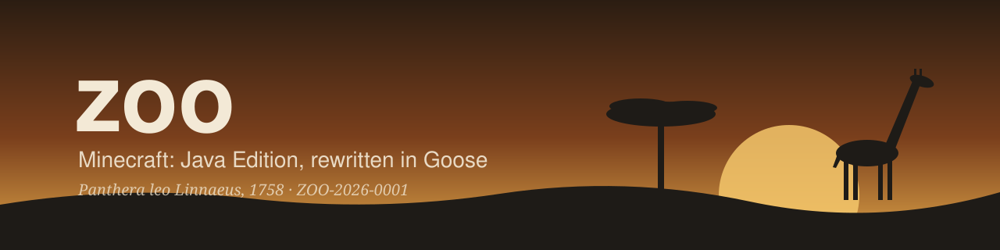
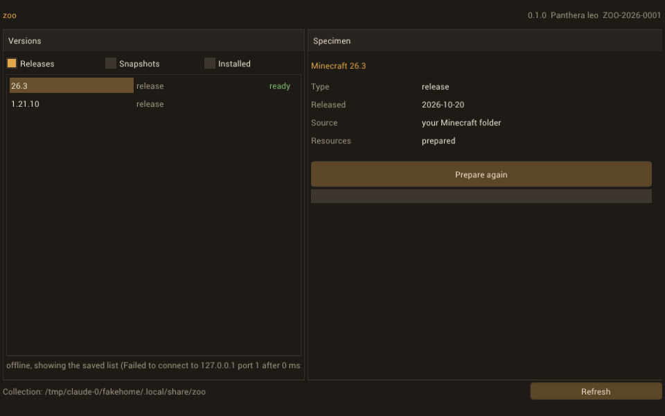
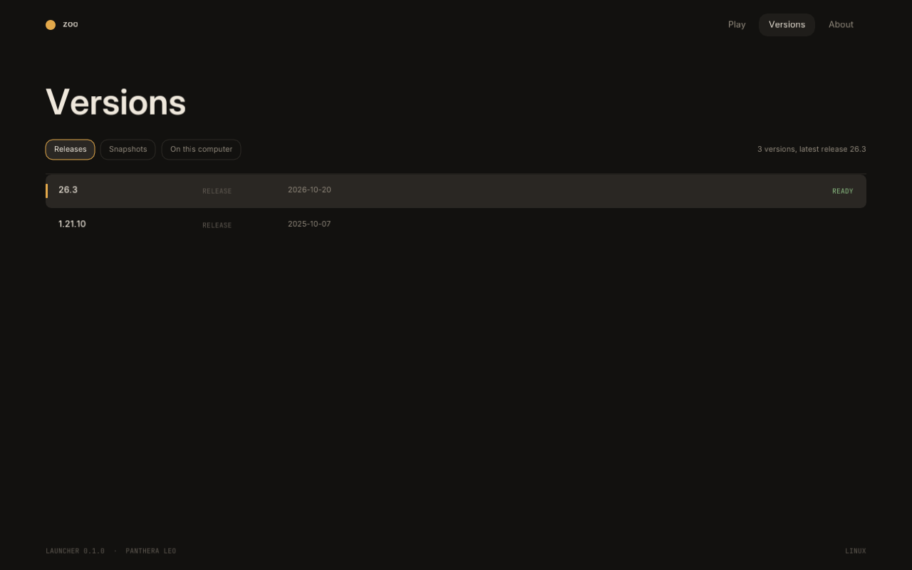
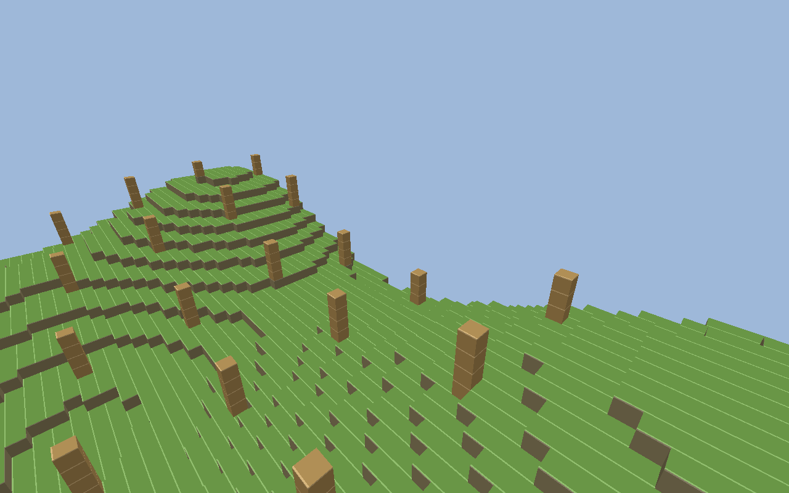

<p align="center">
  
</p>

<p align="center">
  <a href="https://github.com/mariusgxt/zoo-launcher/actions/workflows/ci.yml"></a>
  
  
  
  
  <a href="LICENSE"></a>
</p>

<p align="center">
  <a href="#download"><b>Download</b></a> ·
  <a href="#what-works-today"><b>What works today</b></a> ·
  <a href="#the-client"><b>The client</b></a> ·
  <a href="#roadmap"><b>Roadmap</b></a> ·
  <a href="#build-from-source"><b>Build from source</b></a> ·
  <a href="#versioning-the-specimen-label"><b>Versioning</b></a> ·
  <a href="#modding"><b>Modding</b></a>
</p>

# zoo

zoo is Minecraft: Java Edition rebuilt in [Goose](https://aardappel.github.io/goose/), a memory-safe systems language with no heap allocator and no garbage collector. It follows the path [Horizon](https://github.com/horizon-rust/horizon) took in Rust: a native game that reads the same worlds and plays by the same rules, started through a small launcher that prepares the game's files from your own copy of Minecraft.

This repository holds both. The launcher works today, and the client draws its first worlds.

> Not an official Minecraft product. Not approved by or associated with Mojang or Microsoft. zoo contains no Minecraft code, assets or data: you need your own legally obtained copy of Minecraft: Java Edition.

<table>
  <tr>
    <td width="50%"></td>
    <td width="50%"></td>
  </tr>
</table>

## Download

Builds for Windows x64 and Linux x86-64 are attached to each [release](https://github.com/mariusgxt/zoo-launcher/releases). Unpack the archive and start `zoo-launcher` (`zoo-launcher.exe` on Windows). Nothing else needs to be installed.

**You need** a copy of Minecraft: Java Edition. If the official launcher has already installed a version, zoo uses that jar directly. Otherwise zoo downloads the client jar from Mojang and checks its SHA-1 before using it.

## What works today

- **Version list:** Mojang's version manifest, merged with the versions in your `.minecraft` folder. The list is cached, so it still fills offline.
- **Preparation:** zoo takes the textures, models, block states, atlases, fonts and English names out of the client jar and stores them in its collection folder (`%APPDATA%\zoo` on Windows, `~/.local/share/zoo` on Linux, `~/Library/Application Support/zoo` on macOS). A prepared version is skipped on the next start until its jar changes.
- **Written in Goose:** SHA-1, DEFLATE and zip reading are plain Goose, with no zlib or OpenSSL behind them. The only C is the network door (WinHTTP on Windows, libcurl elsewhere) and a platform probe.
- **The client, first look:** `zoo-client` opens one of your singleplayer worlds and draws it. Anvil region files, NBT, the block palettes, the model chain down to the textures, and a free camera. See [The client](#the-client).
- **A window that stays responsive:** downloads and unpacking run on a worker thread and report back through Goose's typed queues.

## The client

<p align="center">
  
</p>

<sub>Drawn from the demo world in <code>test/data/saves/demo</code> with the stand-in textures of <code>test/data/resources</code>, both written by <code>test/make_fixtures.py</code>, so the picture holds no Minecraft content. With your own prepared version it uses the real textures.</sub>

Prepare a version in the launcher first, then:

```sh
zoo-client --list                 # the worlds in your .minecraft
zoo-client --world "My World"     # open one
zoo-client --radius 6             # load more chunks around the start
zoo-client --check                # the folders zoo uses, and whether they work
```

Click into the window to take the mouse, Escape to give it back. `W A S D` moves, Space and Shift go up and down, Ctrl is faster.

What it draws today is every full block as a cube, with the textures its model chain names. It reads the chunks around one point once, so the world does not grow as you fly. Chunk borders are meshed against their neighbours, so only the edge of what is loaded still shows a wall. Water, leaves and the blocks that are not cubes are missing. Worlds from 1.16 on are read; older ones pack their block indices differently and are refused rather than drawn wrong.

## Roadmap

| Stage | Goal | State |
|---|---|---|
| 1 | Launcher with a GUI: versions, download, checks, resource preparation | working |
| 2 | Zoo client, first look: open a singleplayer world (Anvil, NBT) and render its chunks with the real textures, free camera | working |
| 2b | Chunks loaded and dropped as you move, water, leaves and the blocks that are not cubes | next |
| 3 | Playable: player physics and collision, breaking and placing blocks, saving, HUD | planned |
| 4 | The long road, in Horizon's order: world generation, mobs, redstone, multiplayer protocol, comparison tests against vanilla | planned |
| - | Microsoft account sign-in, several instances, a mod and pack browser | planned |

## Build from source

You need the Goose compiler and a C compiler: Visual Studio 2022 (with "Desktop development with C++") or clang on Windows, gcc or clang elsewhere. On Linux, libcurl's development files are needed too.

On Windows, the prebuilt compiler installs with one command and goes on your PATH:

```powershell
powershell -ExecutionPolicy Bypass -File tools\install-goose.ps1
goose build zoo.goose
.\zoo-launcher.exe
```

On Linux or macOS, unpack the matching archive from [Goose's releases](https://github.com/aardappel/goose/releases) and put its folder on PATH, or build it:

```sh
git clone --branch v2026.3 https://github.com/aardappel/goose
cmake -S goose -B goose/build -DCMAKE_BUILD_TYPE=Release -DGOOSE_BUILTIN_LIBS=all
cmake --build goose/build --config Release

goose build zoo.goose        # builds ./zoo-launcher
goose build client.goose     # builds ./zoo-client
goose tests.goose            # runs the tests
```

The tests use fixtures in `test/data` (a stand-in jar with no Mojang content, made by `test/make_fixtures.py`). The download tests need a local server and skip themselves without one:

```sh
(cd test/data && python3 -m http.server 8765) &
goose tests.goose
```

`ZOO_HOME` moves the collection folder and `ZOO_MANIFEST_URL` points the version list at a mirror. `zoo-launcher --frames 30 --select 26.3 --prepare` runs without input and saves the last frame as `zoo.png`, which is how the screenshot above was taken.

### Layout

```
zoo.goose              the launcher's entry point
client.goose           the client's entry point
zoo/app/               window, theme, version catalogue, worker thread
zoo/collection.goose   finding, downloading, checking and preparing one version
zoo/mojang/            Mojang's manifest and version files
zoo/minecraft/         the official launcher's folder
zoo/world/             NBT, Anvil regions, chunk palettes, saves
zoo/client/            block models, texture atlas, mesher, camera
zoo/image/             PNG
zoo/archive/           zip, DEFLATE, zlib and gzip
zoo/hash/              SHA-1
zoo/net/               HTTP, backed by native/
zoo/specimen.goose     the release catalogue
native/                the C behind extern fn: WinHTTP, libcurl, platform probe
tests.goose            the test runner
```

## Versioning: the specimen label

Each release carries a SemVer number for machines and a museum data tag for people, after the way natural history collections label their specimens with binomial nomenclature:

```
$ zoo-launcher --version
zoo 0.1.0 "Panthera leo" (Lion)
  Panthera leo Linnaeus, 1758
  Accession  ZOO-2026-0001
  Locality   windows
  Collected  2026-11-05
  Prep.      mariusgxt
```

The accession number counts up with every release, the locality is the system the copy runs on, and the collection date is the release date. The catalogue is kept in `zoo/specimen.goose`, where each new release adds a tag and leaves the old ones as they were.

## Modding

Making your own client should be as direct as it was with the Mod Coder Pack. Because the zoo client is readable Goose source, there is nothing to decompile or deobfuscate. The planned workflow:

1. `setup` fetches the source and prepares the resources from your Minecraft jar.
2. You change the code, or add a mod folder.
3. `recompile` and `startclient` build and start your client.

Goose compiles a whole program at once and has no function pointers, so mods join the build instead of being loaded at run time. A mod sees the same types and functions as the game itself.

## Contributing

Issues and pull requests are welcome. Run `goose tests.goose` before sending a change. Code comments are in English and explain why something is done the way it is.

## Licence

MIT, see [LICENSE](LICENSE). Third-party parts are listed in [THIRD_PARTY_NOTICES.md](THIRD_PARTY_NOTICES.md).

## Author

zoo is made by [mariusgxt](https://github.com/mariusgxt).
